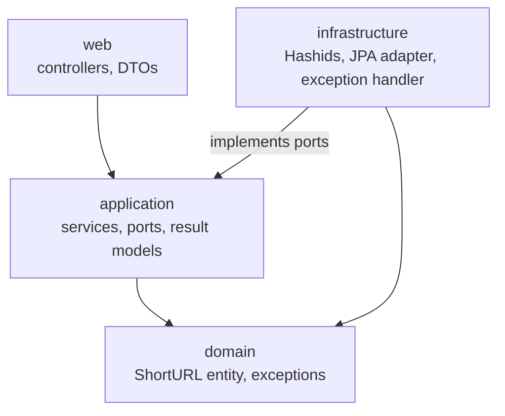
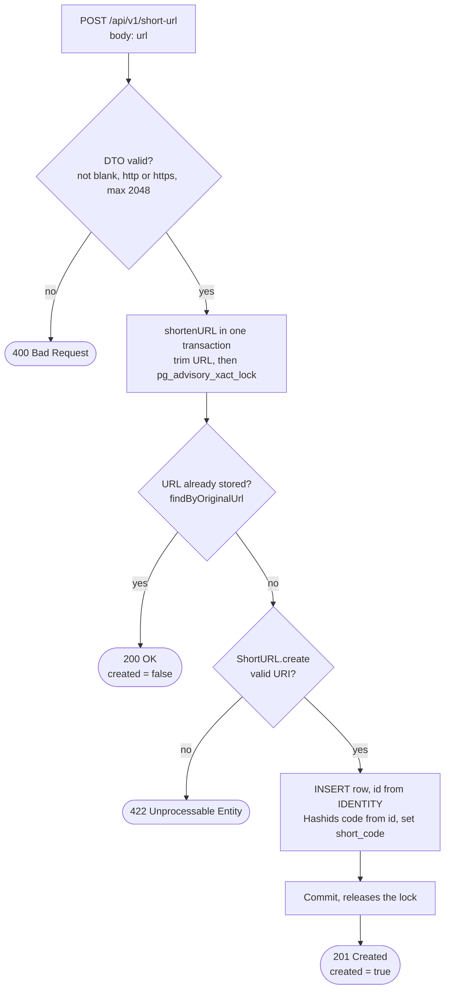
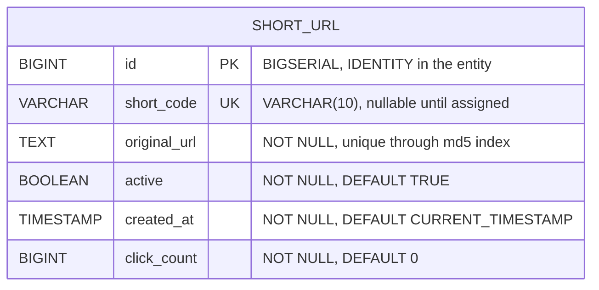

# URL Shortener API


[](LICENSE)

A REST API for shortening URLs, built as a portfolio project.

## Stack
- Java 21
- Spring Boot 3.5 (Web, Data JPA, Validation)
- PostgreSQL 16
- Flyway (database migrations)
- Hashids 1.0.3 (short code generation)
- Lombok
- JUnit 5, Mockito and Testcontainers (tests)
- Docker Compose (local infrastructure)

## Features
- Shortens a URL into a short code generated with [Hashids](https://hashids.org/)
- Returns the same short code when the same URL is submitted again (no duplicate records)
- Redirects short codes to the original URL and counts every click
- Exposes click statistics for a short code
- Validates the submitted URL and returns structured JSON errors

## Architecture

The code is split into layers. Dependencies point inward: `web` and `infrastructure` depend on `application`, and `application` depends on `domain`. The `infrastructure` package implements the ports declared in `application/port`.



### Request flow: `POST /api/v1/short-url`

The service runs in one transaction. Every outcome, success or error, ends at its commit or rollback, which releases the URL lock (see [Design decisions](#design-decisions)).



The lock is the first statement so that concurrent requests for the same URL run one at a time: the second one waits, and its lookup then sees the row the first one committed. This relies on READ COMMITTED (the PostgreSQL default), where each statement sees the data committed before it starts.

## Data model

One table, `short_url`, created by the Flyway migrations `V1` to `V3`. The schema is validated against the entity at startup (`ddl-auto: validate`).



Indexes:
- `UNIQUE (short_code)`
- `UNIQUE INDEX ux_short_url_original_url_md5 ON short_url (md5(original_url))`

## Project structure

```
src/main/java/com/luismiguel/java/url_shortener/
├── UrlShortenerApplication.java
├── application/
│   ├── model/                  ShortenedURLResult, ShortURLStats
│   ├── port/                   CodeGenerator, ShortURLRepository (implemented by infrastructure)
│   └── service/                ShortURLService, ShortURLServiceImpl
├── domain/
│   ├── entity/                 ShortURL
│   └── exception/              DomainException
│       ├── category/           NotFoundException, InvalidInputException
│       └── shorturl/           ShortURLNotFoundException, InvalidURLException
├── infrastructure/
│   ├── codegenerator/          HashidsCodeGenerator
│   ├── exception/              GlobalExceptionHandler
│   └── persistence/repository/ ShortURLJpaRepository, ShortURLRepositoryAdapter
└── web/
    ├── controller/             ShortURLController, RedirectController
    └── dto/shorturl/           request/ShortenURLRequestDTO, response/ShortenedURLResponseDTO,
                                response/GetShortenedURLStatsResponseDTO

src/main/resources/
├── application.yaml
└── db/migration/               V1 to V3 (Flyway)
```

## Getting Started

### Pre-requisites
- JDK 21
- Docker and Docker Compose

### 1. Create the environment file
Copy the example file and fill in the values:

```bash
cp .env.example .env
```

| Variable | Description | Example |
|---|---|---|
| `POSTGRES_DB` | Database name created by the Postgres container | `url_shortener` |
| `POSTGRES_DB_URL` | JDBC URL used by the application | `jdbc:postgresql://localhost:5432/url_shortener` |
| `POSTGRES_DB_USER` | Database user | `postgres` |
| `POSTGRES_DB_PASSWORD` | Database password | `change-me` |
| `HASHIDS_SALT` | Secret salt used to generate short codes. The example value is a weak development placeholder; in production use a long random secret. See [Security notes](#security-notes) | `dev-salt-change-me` |

The `.env` file is ignored by git and is loaded automatically by the application at startup.

### 2. Start the infrastructure
```bash
docker compose up -d
```

This starts PostgreSQL 16 on `127.0.0.1:5432` (only reachable from the local machine).

### 3. Run the application
Via the command line:
```bash
./mvnw spring-boot:run
```

Or from your IDE, running the main class `UrlShortenerApplication`.

The API is available at `http://localhost:8080`. Flyway applies the database migrations on startup.

## Endpoints

### Shorten a URL
`POST /api/v1/short-url`

Request:
```json
{
  "url": "https://example.com/some-long-page"
}
```

Response (`201 Created` for a new URL):
```json
{
  "shortCode": "DQm5Q0",
  "originalURL": "https://example.com/some-long-page"
}
```

`201 Created` when the URL is new, `200 OK` when it was already shortened (same body).

### Get statistics
`GET /api/v1/short-url/{code}/stats`

Response (`200 OK`):
```json
{
  "shortCode": "DQm5Q0",
  "originalURL": "https://example.com/some-long-page",
  "clickCount": 42,
  "createdAt": "2026-10-14T11:20:00"
}
```

### Redirect
`GET /{code}` redirects (`302 Found`) to the original URL and increments the click count.

### Interactive API documentation
- Swagger UI: `http://localhost:8080/swagger-ui/index.html`
- OpenAPI JSON: `http://localhost:8080/v3/api-docs`

In production, the UI can be disabled with `springdoc.swagger-ui.enabled=false`, and the JSON document with `springdoc.api-docs.enabled=false`.

## Error responses

Errors share the same JSON structure:

```json
{
  "timestamp": "2026-10-14T14:03:12.345Z",
  "status": 404,
  "error": "NOT_FOUND",
  "message": "Short URL with shortCode: DQm5Q0, not found!",
  "path": "/api/v1/short-url/DQm5Q0/stats"
}
```

| Status | When |
|---|---|
| `400 Bad Request` | Missing or malformed request body, or validation failed (missing or invalid `url`) |
| `404 Not Found` | The short code does not exist, or the path does not match any resource |
| `405 Method Not Allowed` | The HTTP method is not supported for the endpoint |
| `415 Unsupported Media Type` | The request content type is not supported |
| `422 Unprocessable Entity` | The URL passed the request validation but cannot be parsed as a URI |
| `500 Internal Server Error` | Unexpected error (the response does not include stack traces) |

## Design decisions

- **Hashids over IDENTITY ids.** The code is derived from the database id, which is unique, so two URLs never get the same code and no collision handling is needed. Hashids obfuscates the id; it does not protect it (see [Security notes](#security-notes)). The `CodeGenerator` port allows switching to random codes later.
- **Code length limit.** With `app.hashids.min-length: 6`, codes have 6 to 10 characters, and the 11th character appears from id ~6.2e14 (measured with Hashids 1.0.3). The column is `VARCHAR(10)`, so past that point the `short_code` update fails. Widening the column needs a new migration.
- **Functional MD5 index for `original_url`.** A btree entry is limited to about 2.7 KB, so the `TEXT` value is not indexed directly. The unique index is on `md5(original_url)`, and the lookup repeats the expression and adds `original_url = :url`, so the index is used and the match is exact.
- **Advisory lock for deduplication.** `shortenURL` runs `pg_advisory_xact_lock(hashtextextended(url, 0))` as its first statement, so concurrent requests for the same URL are serialized and the lock is released at commit or rollback. The lock must be taken before the read, and the transaction relies on the PostgreSQL default isolation (READ COMMITTED). The alternatives, an upsert or catching the constraint violation, are harder to reason about: a constraint error aborts the PostgreSQL transaction, so the retry needs a new one.
- **201 vs 200.** `POST` returns `201 Created` when a row is created and `200 OK` when the URL already exists. The `created` flag lives in the application model (`ShortenedURLResult`) and is not serialized, so both responses have the same body.
- **Layered validation.** The DTO checks that the URL is `http`/`https` and at most 2048 characters (400). The domain (`ShortURL.create`) checks that the URL is a valid `java.net.URI` (422). The domain check exists because the redirect calls `URI.create`, so a string accepted by the DTO but not parseable would otherwise fail with 500 at redirect time.
- **Errors by category.** Domain exceptions extend `NotFoundException` or `InvalidInputException` and carry no HTTP status. Only `GlobalExceptionHandler` maps categories to HTTP statuses (404 and 422). A new exception only needs to extend an existing category.
- **Atomic click counting.** Clicks are counted with a single `UPDATE short_url SET click_count = click_count + 1` in the database, so concurrent redirects do not lose increments.
- **302 Found instead of 301 for redirects.** `GET /{code}` answers `302 Found` (`HttpStatus.FOUND`) with the original URL in `Location`. A `301` is permanent and browsers and proxies cache it, so after the first visit clients would stop calling the server and `click_count` would miss the later visits. A `302` is temporary, so every visit reaches the server and is counted, and the destination can change or be disabled later without being stuck in caches (this keeps that option open). The trade-off is more load on the server per click and no cache or SEO benefit from a `301`; for a shortener with statistics, counting clicks is worth more. If counting stops being a requirement, switch to `301` or set an explicit `Cache-Control`.
- **Persistence settings.** `spring.jpa.open-in-view` is `false`, so lazy loading outside a transaction fails instead of running silently in the web layer. `show-sql` is not enabled in the base configuration.
- **JPA entity in the domain (pragmatic choice).** `ShortURL` keeps its JPA and Lombok annotations inside `domain`. Separating a domain model from a persistence entity would double the classes and need mappers for a single-table model. `ShortURLRepositoryAdapter` is the only access point to the entity, so extracting a separate JPA entity later stays localized.
- **Accepted limit.** `application` still uses Spring (`@Service`, `@Transactional`) and Lombok. Neither `application` nor `domain` imports `infrastructure` or `web`.

## Testing

```bash
./mvnw test
```

Docker must be running: the tests that use PostgreSQL (`ShortURLServiceConcurrencyTest` and `UrlShortenerApplicationTests`) start a `postgres:16-alpine` container with Testcontainers through `TestcontainersConfiguration`.

| Group | What it covers |
|---|---|
| Domain | `ShortURLUnitTest`: URL creation and validation, normalization, short code assignment |
| Service | `ShortURLServiceImplUnitTest`: shortening and deduplication (including the lock order), redirect lookup and stats, with mocked ports |
| Code generation | `HashidsCodeGeneratorUnitTest`: determinism, uniqueness and minimum length of codes |
| DTO validation | `ShortenURLRequestDTOTest`: `http`/`https` only and the 2048 character limit |
| Controller | `ShortURLControllerTest` (`@WebMvcTest`): `201` for new URLs, `200` for existing ones, `400` for a disallowed scheme |
| Error handling | `GlobalExceptionHandlerTest`: JSON error body and status for the handled exceptions, including the generic `500` (standalone MockMvc) |
| Concurrency | `ShortURLServiceConcurrencyTest`: concurrent shortening against real PostgreSQL: a second transaction waits for the first and reuses its row, 20 concurrent requests for one URL produce a single row, and different URLs get distinct codes |
| Context | `UrlShortenerApplicationTests`: full application context on PostgreSQL, so Flyway migrations and schema validation run |
| API docs | `OpenApiDocsTest`: the OpenAPI document lists the paths and responses, and the Swagger UI is served next to the `/{code}` redirect route |

## Security notes

- **Salt.** The default salt (`dev-salt-local`) and the placeholder in `.env.example` are weak on purpose and exist only for development. In production, set a long, random `HASHIDS_SALT` kept as a secret, and do not reuse it across environments.
- **Short codes are obfuscated, not encrypted.** Hashids encodes sequential database ids, so codes can be enumerated, and decoded by anyone who knows the salt. This is an accepted trade-off, the same as in public URL shorteners. `CodeGenerator` is a port, so codes can be replaced with random ones without touching the rest of the application.
- **Statistics exposure.** The original URL is already public through the redirect (`GET /{code}`), so `GET /api/v1/short-url/{code}/stats` exposes nothing beyond `clickCount` and `createdAt`.
- **Database exposure.** The Compose file binds PostgreSQL to `127.0.0.1` only.
- **No rate limiting yet.** Requests are not throttled. Rate limiting is on the roadmap.

## License

Distributed under the MIT License. See [LICENSE](LICENSE) for details.
